# Power Electronics & Drive Control in PLECS

Three converter control projects, each built up step by step in PLECS: sizing the power stage, validating it open loop, then designing and tuning cascaded PI control and testing it against disturbances.

| Project | What it covers |
|---|---|
| [Boost converter](#1-dcdc-boost-converter-30-v--70-v-500-w) | Component sizing, small-signal transfer functions, RHP zero, cascaded current and voltage control |
| [DC drive](#2-converter-fed-dc-motor-drive) | Cascaded current and speed control of a DC machine, anti-windup, load disturbance rejection |
| [Single-phase inverter](#3-single-phase-dcac-inverter) | Bipolar vs unipolar PWM and FFT analysis, standalone voltage control, grid-connected operation with a PLL |

All solo work for the **Control of Energy Conversion Systems** and **Control of Electrical Drives** courses at Warsaw University of Technology (2025–2026). Each folder holds the PLECS models and the full report.

The follow-up to the inverter project, a SOGI-PLL designed from scratch, has its own repository: [sogi-pll](https://github.com/nkokhtashvili/sogi-pll).

---

## 1. DC/DC boost converter (30 V → 70 V, 500 W)

📁 [`boost-converter/`](boost-converter)

**Design brief:** 30 V in, 70 V out, 500 W, 35 kHz switching, inductor current ripple under 30%, output voltage ripple under 2%.

**Sizing (ideal model):**

| Duty cycle D | Load R | Inductance L | Capacitance C |
|---|---|---|---|
| 0.571 | 9.8 Ω | ≥ 98 µH | ≥ 83.3 µF |

**Open loop, then rated operation.** Adding parasitic resistances showed how far the ideal values fall short, which told me exactly where compensation was needed. After correcting for the losses, the model settled at **70.02 V with 15.6 A** of inductor current, with both ripples inside the limits.

**Small-signal model.** I derived the control-to-current and control-to-voltage transfer functions:

```
Gid(s) = iL(s)/d(s)   = (714286·s + 1.75e9)  / (s² + 1225·s + 2.25e7)
Gvd(s) = vout(s)/d(s) = (−200084·s + 3.67e9) / (s² + 1225·s + 2.25e7)
```

The negative term in Gvd(s) is a **right-half-plane zero**: raise the duty cycle and the output first dips, because the capacitor briefly feeds the load alone while the inductor charges. A 5% duty step gave the same ≈ 4.7 A current change in the averaged model and the switching model, which validated the transfer function.

**Control design, and what broke along the way**

- **Current loop:** P control at K = 1 oscillated badly, K = 0.1 was smooth. Adding a realistic DSP delay and zero-order hold cut the stability margin, so K had to drop to 0.05. Switching to PI removed the steady-state error.
- **Voltage loop:** P control alone plateaued at 30 to 40 V and could never reach 70 V. It needs a nonzero error to produce any output, and the RHP zero makes cranking up the gain unstable, so an integral term is mandatory.
- **Final cascade:** outer voltage PI → current reference → inner current PI → duty cycle, with anti-windup limits. The duty cycle is capped at 0.95, because reaching 1.0 would short the inductor permanently, and the current reference is capped to prevent startup spikes.

| Final cascaded control in PLECS | Holding 70 V through input and load steps |
|---|---|
| 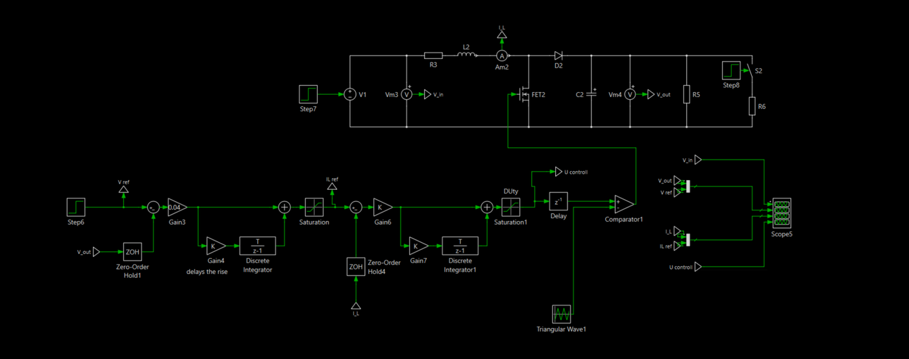 | 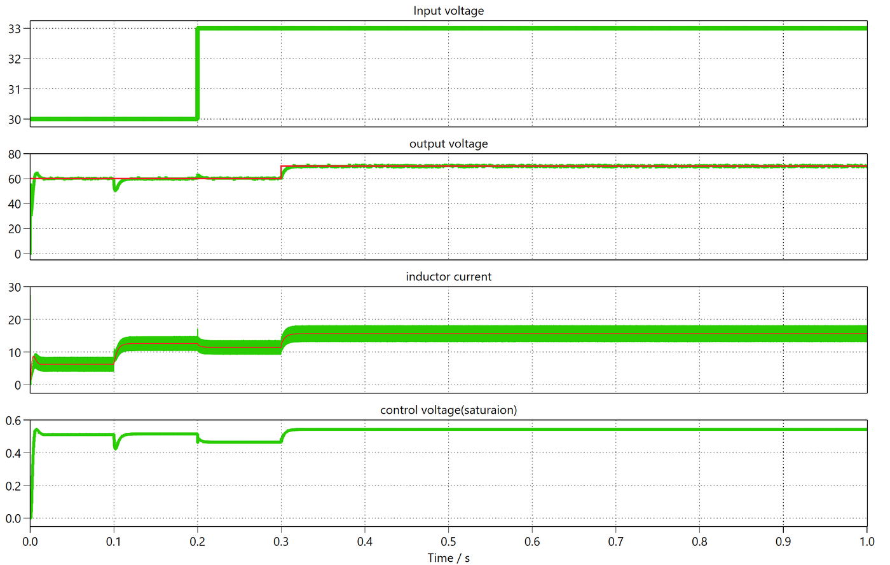 |

| Current loop with DSP delay | Voltage loop stuck below target with P-only control |
|---|---|
| 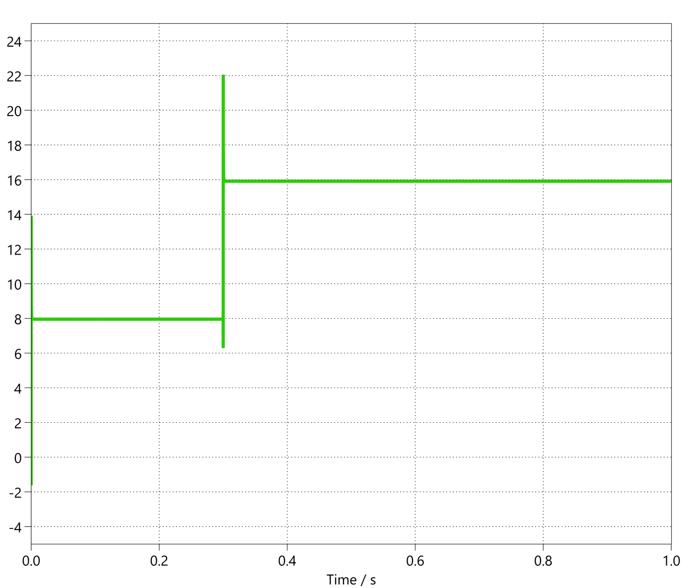 | 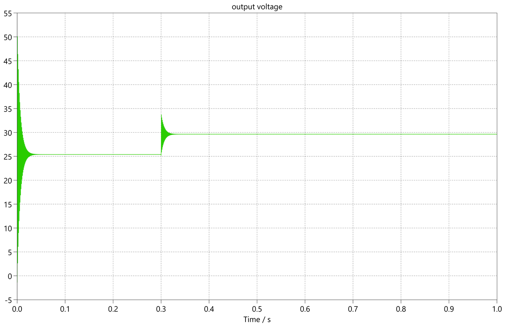 |

Models: `1_baseline_open_loop` → `2_rated_operation` → `3_transfer_function_validation` → `4_cascaded_control_final`

---

## 2. Converter-fed DC motor drive

📁 [`dc-drive-control/`](dc-drive-control)

A DC machine supplied from an H-bridge converter, taken from open loop to a full cascaded current and speed controller.

**Open loop.** Raising the load torque slows the motor, which lowers the back EMF (E = kΦω), so more armature current flows. Speed sags with every load change.

**Inner current loop**

- PI controller, with a zero-order hold for measurement sampling and a unit delay for digital latency
- **Tuning trick:** the rotor inertia was temporarily raised from J = 0.2 to J = 200,000. With speed effectively frozen, the back EMF stays constant and the armature becomes a simple RL circuit that is easy to tune
- Integral time set to the armature time constant (Ti = La/Ra), and Kp tuned to **0.05** for 2 to 10% overshoot and a clean control signal
- Anti-windup with output limits of ±1

**Outer speed loop** (inertia restored to nominal)

- Cascade: n_ref → speed PI → I_a,ref → current PI → U_c → PWM → H-bridge → motor
- With the integral part switched off, Kp was tuned to **0.5** for a 1 to 2% no-load speed error, then Ti was set to **0.09** for a smooth return to the reference after load steps
- The speed controller's output is limited so the current reference stays within the machine's allowable overload

**Result:** with both loops active, armature current rises and falls with the load, and **speed stays practically constant**.

| Speed loop under a load step | Speed controller with output limiting |
|---|---|
| 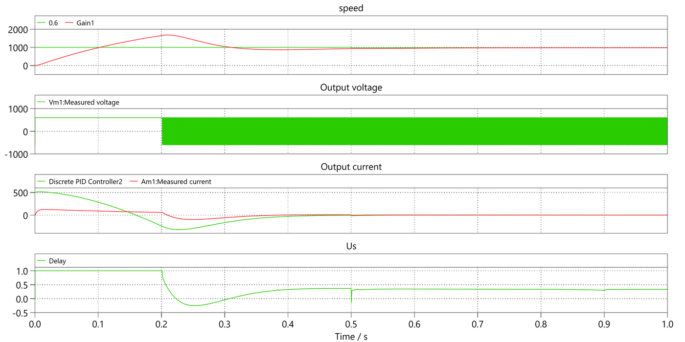 | 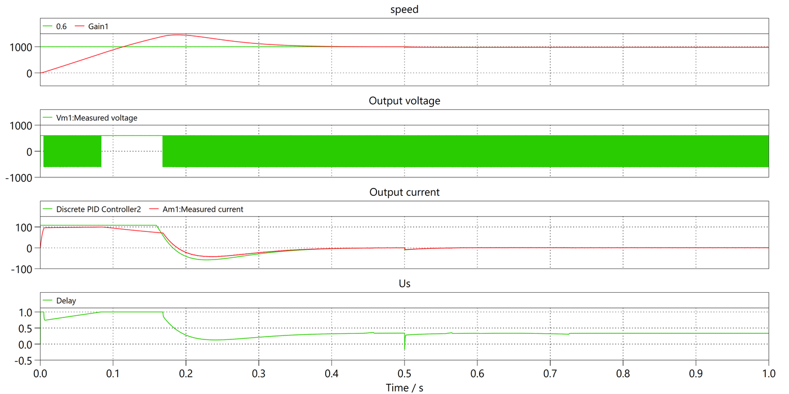 |

---

## 3. Single-phase DC/AC inverter

📁 [`single-phase-inverter/`](single-phase-inverter)

H-bridge inverter from a 400 V DC link with a 5 kHz carrier, taken from PWM analysis to standalone voltage control to grid-connected operation.

**Bipolar vs unipolar PWM.** FFT analysis (50 Hz base, 250 harmonics, matched to the fundamental to avoid spectral leakage) showed the same fundamental for both, but unipolar PWM pushes the dominant switching harmonics from 5 kHz up to about 10 kHz, which makes filtering easier. A modulation index sweep (0.4, 0.8, 2, 50) showed linear scaling up to 1, then overmodulation, with the waveform moving towards a square wave and low-order harmonics climbing.

| Unipolar PWM spectrum (ma = 1) | Bipolar PWM spectrum (ma = 1) |
|---|---|
| 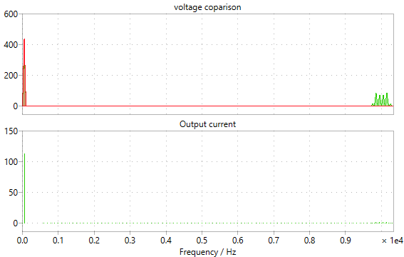 | 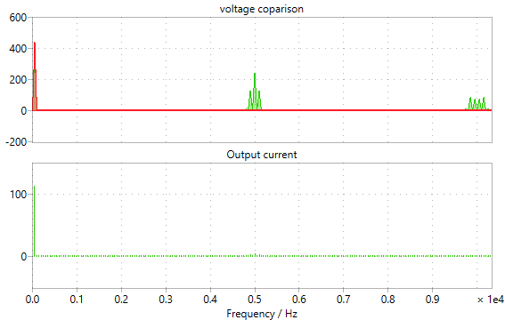 |

**Standalone control (350 V target)**

- **Open loop:** switching in an extra 5 Ω load made the output voltage sag, with nothing to correct it
- **Inner current loop:** PI with load-voltage feedforward, output limited to ±1 to match the PWM carrier. It tracks a 50 A, 50 Hz reference; the remaining ≈ 10 A peak-to-peak ripple is set physically by the 5 kHz switching across the 2 mH inductor
- **Cascaded voltage loop:** outer voltage PI feeding the current reference, with limits widened to ±200 A. At the load step (t = 0.25 s) current jumps from about 100 A to 175 A while **the voltage holds at 350 V**

| Open loop: voltage sags at the load step | Cascaded control: voltage held, current steps up |
|---|---|
| 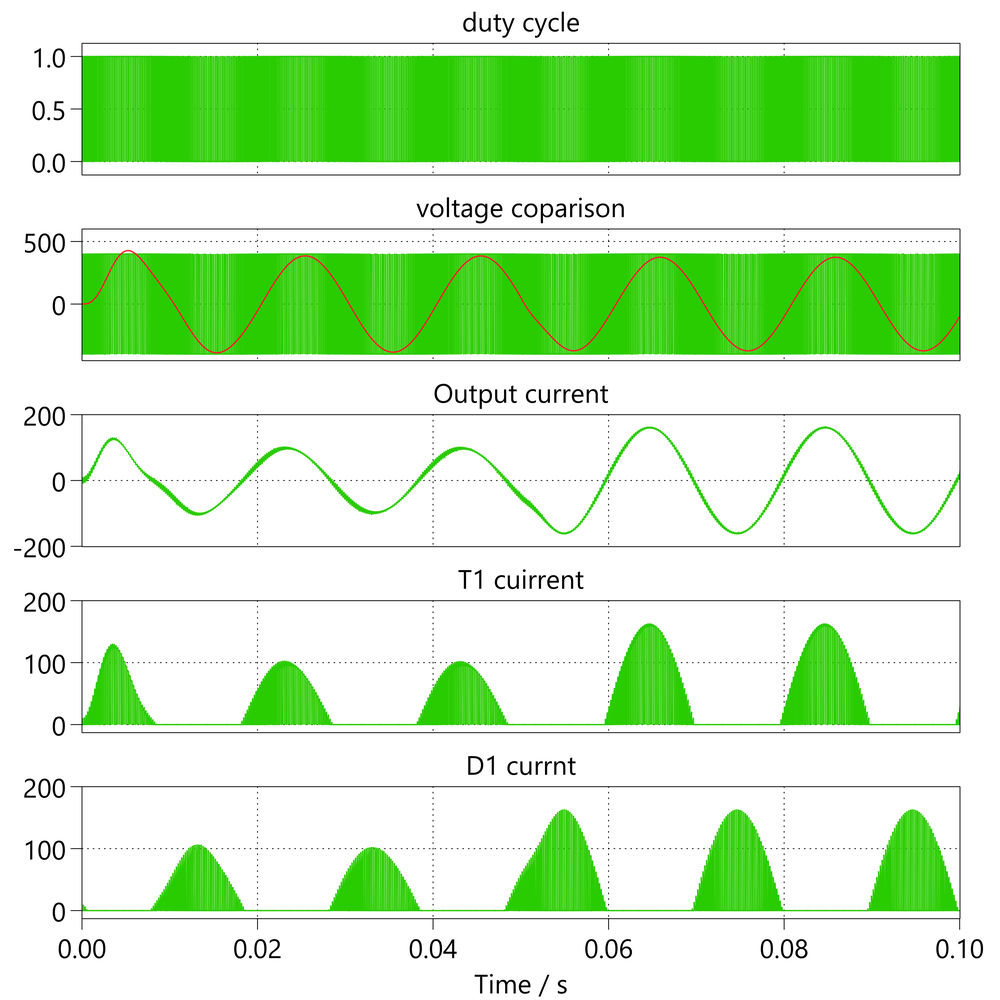 | 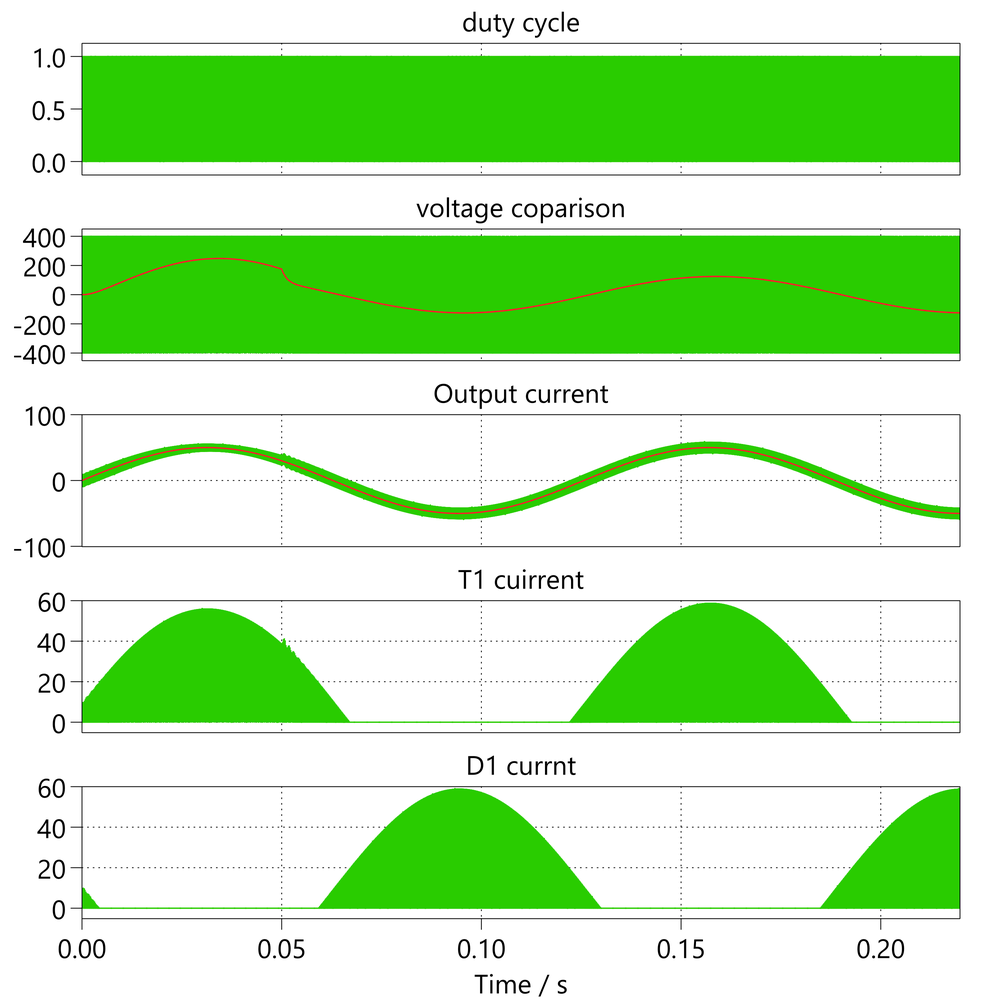 |

**Grid-connected operation (325 V peak, 50 Hz).** On the grid the inverter stops regulating voltage and becomes a controlled current source. It tracks a 200 A reference with grid-voltage feedforward; the converter voltage has to sit slightly above the grid's to push current through the 2 mH inductor. A PLL then provides the grid angle, and shifting the current reference by π/2 switches between **active and reactive power**. It stayed locked when the grid phase was moved to π/3.

| Active power: current in phase | Reactive power: current shifted 90° |
|---|---|
| 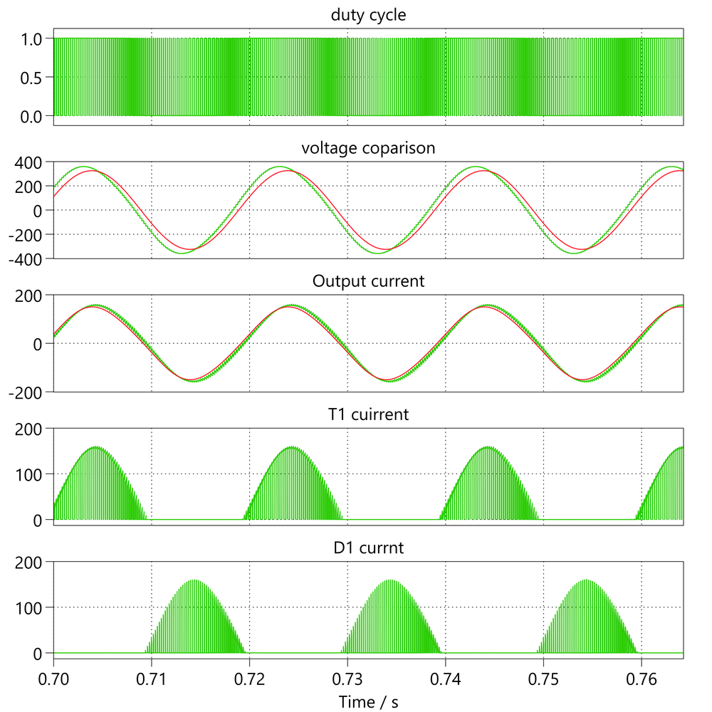 | 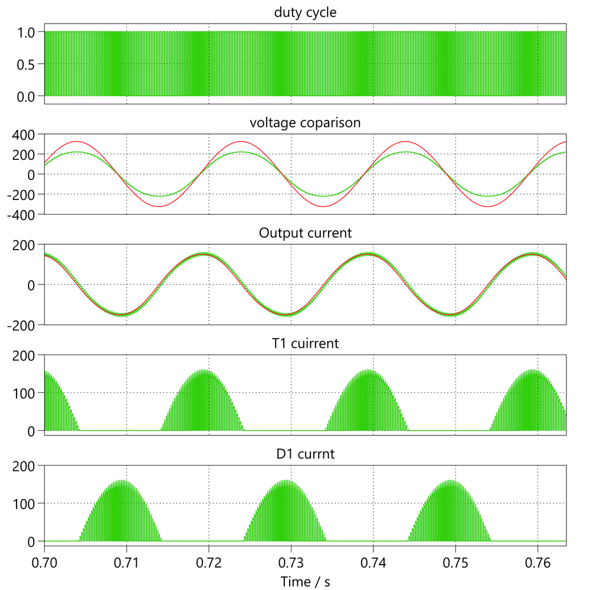 |

Models: `1_hbridge_pwm` → `2_open_loop_voltage` → `3_closed_loop_current` → `4_cascaded_voltage_control` → `5_grid_connected_pll`

---

## Running the models

Open any `.plecs` file in PLECS Standalone and start the simulation. The numbered files in each folder follow the order of the report.

## Tools

PLECS, MATLAB, LaTeX for the reports.
